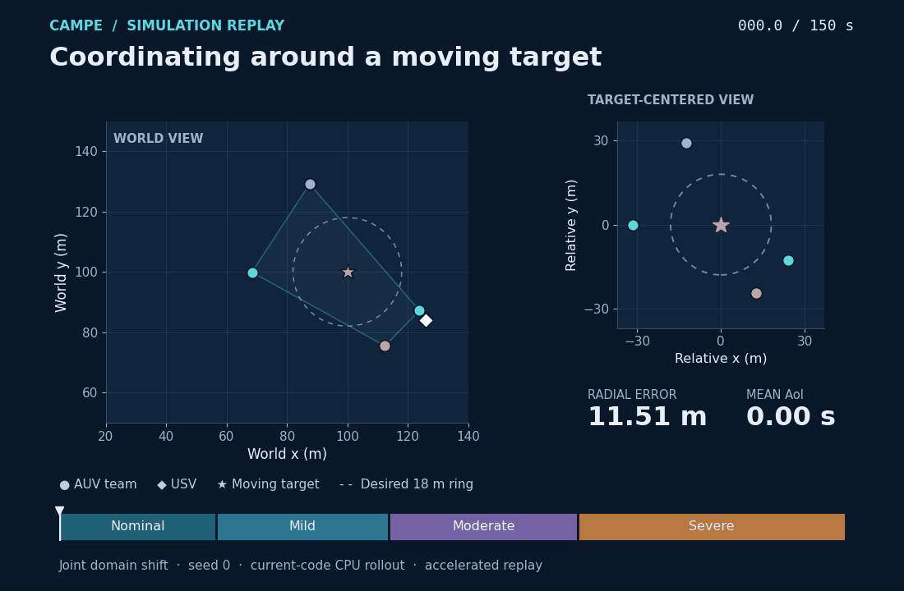
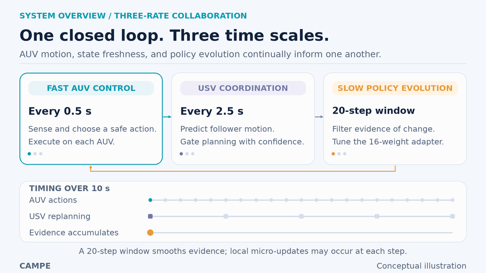
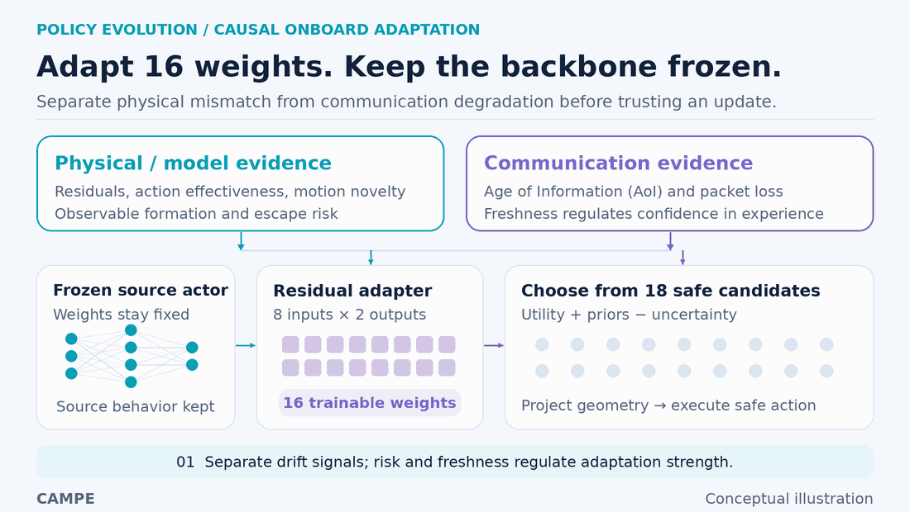
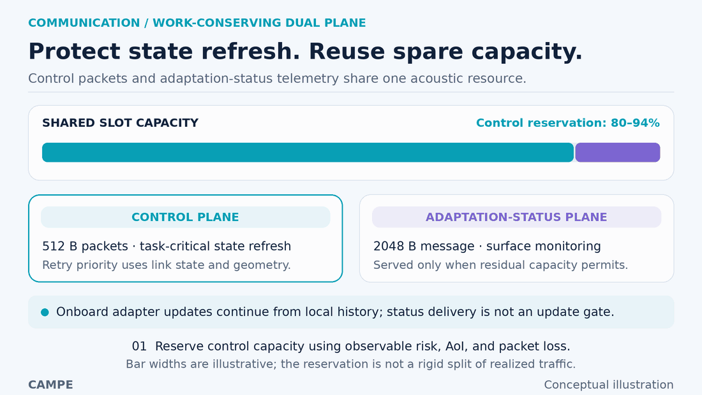
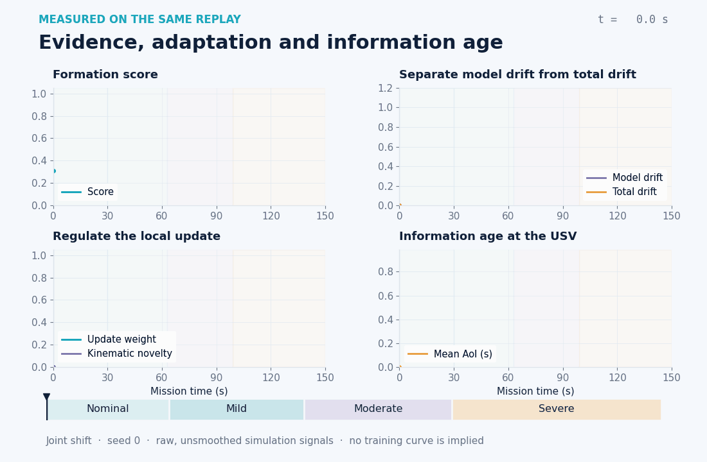
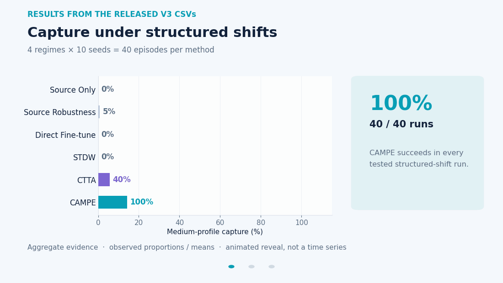

<h1 align="center">CAMPE</h1>

<p align="center"><strong>Communication-Aware Markov Policy Evolution</strong><br>
Adaptive USV–AUV collaboration under changing dynamics and unreliable acoustic links.</p>

<p align="center">
  <a href="#overview">Overview</a> ·
  <a href="#how-campe-works">Method</a> ·
  <a href="#results">Results</a> ·
  <a href="#quick-start">Quick start</a> ·
  <a href="#reproduce-the-experiments">Reproduce</a> ·
  <a href="#paper-and-citation">Paper</a>
</p>

<p align="center">
  
</p>

<p align="center"><em>Current-code simulation · Joint shift · seed 0 · 150 simulated seconds.<br>
Left: world coordinates. Right: target-centered geometry. <a href="assets/stills/mission_replay.png">Static view</a></em></p>

| Lightweight adaptation | Structured shifts | Additional OOD conditions | Matched-resource coordination |
|:---:|:---:|:---:|:---:|
| **16** online policy parameters | **40/40** successful captures | **58%** capture versus **49%** for CTTA | **0.93 s** AoI versus **1.51 s** for FIM Only |

The capture figures use the fixed **medium** evaluation profile. Structured shifts and OOD conditions are separate protocols; the sample counts and comparison settings are given below.

## Overview

**How can a robot team keep collaborating when both the environment and the communication network change after deployment?**

An unmanned surface vehicle (**USV**) supports multiple autonomous underwater vehicles (**AUVs**) as they surround a moving target. Currents, actuator effectiveness, sensing quality, target behavior, and acoustic links can all change during a mission. A delayed state update can look like a change in the vehicle dynamics, while moving the USV changes which underwater agents can communicate reliably.

CAMPE treats this as **latent Markov-domain evolution** and connects three decisions in one closed loop:

1. **How should the AUV policy adapt?** Separate physical/model mismatch from communication degradation, then regulate a small residual adapter using observed reliability and risk.
2. **Which traffic should receive the shared acoustic capacity?** Protect task-critical state refresh and let adaptation-status telemetry use the capacity remaining after actual control transmissions.
3. **Where should the USV move?** Predict follower motion when cached information is sufficiently reliable, with a Fisher Information Matrix (**FIM**) baseline as the fallback.

**Age of Information (AoI)** measures how old the most recently received state is. Lower AoI gives the coordinator fresher information. The FIM term describes the informativeness of the current localization geometry.

The release contains a two-dimensional numerical simulator, frozen source checkpoints, deployment-time adaptation, six evaluation families, and **1,550 per-seed evaluation records**. Sensitivity settings can reuse trajectories under different capture criteria, so this count describes records rather than unique missions.

## How CAMPE works

### 1. Coordinate three time scales

<p align="center"></p>

The default AUV control interval is **0.5 s**; the USV replans every **5 control steps, or 2.5 s**. A **20-step evidence window** controls the slower drift-filtering time scale. Local adapter micro-updates can still occur at each fast step: the evidence window is not a fixed 20-step update schedule.

*Conceptual illustration · [Static view](assets/stills/three_rate_loop.png)*

### 2. Adapt a small policy residual from causal evidence

<p align="center"></p>

The source actor stays frozen. Only an **8 × 2 residual matrix** is adapted online. The controller estimates transition residuals, action effectiveness, and persistent target-motion novelty from available observations; it does not receive privileged deployment-domain labels or future simulator states.

CAMPE evaluates **18 action candidates** using short rollouts under residual/effectiveness estimates, observable mode priors, and an uncertainty penalty. Reliability and task risk regulate adaptation strength. Geometric safety projection, action/parameter trust regions, and a consolidated low-drift anchor constrain changes. The executed action can therefore combine the source behavior, analytic corrections, and the learned residual.

*Conceptual illustration · [Static view](assets/stills/policy_evolution.png)*

### 3. Protect state refresh and reuse spare capacity

<p align="center"></p>

The two planes share one slot-level byte budget. For Full MPC, **80–94% is reserved for control opportunities**, depending on observed pressure. Actual use depends on packet delivery and retries; unused control capacity becomes available for status traffic within the same slot. Retry priority accounts for link quality, state age, and formation geometry.

**Adaptation-status telemetry supports surface-side monitoring/logging. The adapter learns locally from onboard history, and successful telemetry delivery is not a prerequisite for an update.** The variable name `learning_bytes` in historical result files refers to this status traffic.

The USV then uses link-quality-aware follower prediction to evaluate mobility choices. A predictive correction is accepted only when confidence, score improvement, and the FIM floor all pass their gates; otherwise the common FIM waypoint is retained. The accepted correction is bounded, preserving the shared mobility budget.

*Conceptual illustration · [Static view](assets/stills/dual_plane.png)*

### 4. Inspect what happens during a mission

<p align="center"></p>

These are **raw, unsmoothed signals from the same newly recorded episode as the opening replay**. The panels connect formation quality to drift estimates, local update strength, and information age. The phase labels describe the simulator's Joint-shift schedule for visualization; the controller receives observations, not those phase labels.

*Simulation replay · [Static view](assets/stills/adaptation_signals.png) · [Trace CSV](assets/data/campe_joint_seed0_trace.csv) · [Configuration and provenance](assets/data/campe_joint_seed0_metadata.json)*

## Results

<p align="center"></p>

The animation reveals **aggregate results from the released V3 CSVs**; its progression is not training time. Bars show observed proportions or means. The manuscript's Tables II–IV provide the full statistical reporting.

| Evaluation | CAMPE / Full MPC | Comparator | Scope and source |
|---|---:|---:|---|
| Medium capture under structured shifts | **100% (40/40)** | CTTA: 40% (16/40) | 4 regimes × 10 seeds per method; Table II; `adaptation_raw.csv` |
| Mean radial error under structured shifts | **1.47 m** | CTTA: 1.90 m | Same 40 runs per method; Table II; `adaptation_raw.csv` |
| Medium capture under additional OOD conditions | **58% (58/100)** | CTTA: 49% (49/100) | 10 scenarios × 10 seeds per method; Table III; `robustness_raw.csv` |
| Mean AoI under communication/mobility stress | **0.93 s** | FIM Only: 1.51 s | 5 scenarios × 10 seeds per planner; Table IV; `control_plane_raw.csv` |

In the coordination comparison, the follower controller is fixed to CAMPE. All movable-USV planners share the same bandwidth, speed limits, and movement budget; the Fixed USV baseline remains stationary. Full MPC lowers mean AoI by approximately **38.4%** relative to FIM Only in this protocol.

These results establish comparative performance within the supplied simulation and baseline implementations. The harder OOD suite includes failures, and CAMPE does not dominate every scenario or every metric. For example, its structured-shift AUV energy is higher than CTTA's even as capture and geometry improve. Physical experiments and field-calibrated acoustic models remain future work.

*CSV-derived visualization · [Static results](assets/stills/benchmark_results.png) · [Exact aggregates and source hashes](assets/data/benchmark_summary.json)*

<details>
<summary><strong>All structured-shift baselines and code keys</strong></summary>

Each success percentage below is observed over **10 seeds for that regime**.

| Paper-facing method | Code key | Gradual | Sudden | Joint | Recurrent |
|---|---|---:|---:|---:|---:|
| Source Only | `source_only` | 0% | 0% | 0% | 0% |
| Source Robustness | `domain_randomization` | 0% | 20% | 0% | 0% |
| Direct Fine-tune | `direct_finetune` | 0% | 0% | 0% | 0% |
| STDW | `stdw` | 0% | 0% | 0% | 0% |
| CTTA | `ctta` | 70% | 40% | 20% | 30% |
| **CAMPE** | `campe` | **100%** | **100%** | **100%** | **100%** |

STDW and CTTA are task-adapted continuous-control implementations sharing the release's interface and protocol. `domain_randomization` is a legacy key for the Source Robustness branch; it does not indicate a separately trained randomized-domain policy in this release. `direct_finetune` updates the residual adapter while the source actor remains frozen.

</details>

## Quick start

### 1. Download and unpack the release

The public repository distributes its implementation in **[Code.zip](Code.zip)**. The outer repository contains this README and its visual assets; the extracted project is the inner `Code/` directory.

```bash
git clone https://github.com/Self-evolution/Code.git campe-release
cd campe-release

python -m zipfile -e Code.zip .
cd Code

# Restore the result tables and figures from the bundled artifact archive.
tar -xzf CAMPE_V3_FINAL_ARTIFACTS.tar.gz results
```

The last command extracts only `results/`. The bundled archive also contains a historical README. If the project was obtained as an already expanded folder, work from the directory containing `campe/`, `checkpoints/`, and `requirements.txt`.

### 2. Install the runtime

Python **3.12** is a verified environment for this release. Install the project's declared dependencies:

```bash
python -m venv .venv
source .venv/bin/activate
python -m pip install -r requirements.txt
```

On Windows PowerShell, activate with `.venv\Scripts\Activate.ps1` instead. The requirements list NumPy, pandas, SciPy, Matplotlib, and PyTorch. A CPU build of PyTorch is sufficient for the validation/demo path below; the full experiment runners require a CUDA-enabled installation.

### 3. Validate the saved results and run a smoke episode

```bash
python validate_v2.py --root .
python validate_v2.py --root . --smoke --seeds 0
```

Validation checks finite recorded metrics, mutually exclusive mission outcomes, and capture-profile consistency. The six released raw tables contain **1,550 records** and pass with zero reported protocol errors. The smoke test uses a difficult scenario; a valid `timeout` mission outcome is not an execution failure.

### 4. Record a CPU demonstration

From the extracted `Code/` directory, the additional documentation helper records the same default scenario used in the README:

```bash
python ../visual_tools/record_demo.py \
  --project-root . \
  --output-dir demo_output \
  --scenario joint \
  --method campe \
  --planner full_mpc \
  --seed 0
```

This loads the supplied frozen `td3_4auv.pt` checkpoint and writes `demo_output/trace.csv` plus `trace_metadata.json`. It records the source hashes, configuration, episode metrics, and per-step state. The default device is CPU; pass `--device cuda` to use an available GPU.

## Reproduce the experiments

The complete protocol uses the supplied checkpoints. Run these commands from the **extracted project directory on a CUDA-enabled Linux system**:

```bash
python run_sharded_v2.py \
  --root . \
  --mode full \
  --shards-per-stage 10 \
  --max-parallel 4 \
  --archive-results

python validate_v2.py --root .
python analyze_v2.py --root . --output results/v3_analysis.json
python generate_report_v2.py --root .
```

Adjust `--max-parallel` to the available hardware. `--archive-results` moves the existing result directory aside before a new run. Despite their filenames, the current `*_v2.py` runners and report builder are used by the supplied V3 release.

To run selected families:

```bash
python run_sharded_v2.py --root . --mode full \
  --stages adaptation robustness --max-parallel 4
```

| Stage | Question | Recorded rows |
|---|---|---:|
| `domain_shift` | How does the frozen source policy respond to isolated changes? | 80 |
| `adaptation` | How do six methods handle gradual, sudden, joint, and recurrent shifts? | 240 |
| `safety_ablation` | What do the individual CAMPE mechanisms contribute? | 330 |
| `control_plane` | How do six USV coordinators compare under matched resources? | 300 |
| `robustness` | How do four methods handle ten additional OOD conditions? | 400 |
| `sensitivity` | How do capture criteria, parameters, resources, and team size affect outcomes? | 200 |
| **Total** | | **1,550** |

Main experiments use seeds **0–9**; sensitivity experiments use **0–4**. The released GPU metadata records an NVIDIA RTX 4090. Runtime measurements from those experiments should be interpreted in that hardware context.

<details>
<summary><strong>What counts as a successful capture?</strong></summary>

Capture requires radial accuracy, a bounded maximum angular gap, target containment, and safe inter-AUV separation. These conditions must hold for a continuous interval, and the final 60-step window must satisfy stability and score requirements. Collision, boundary violation, or escape invalidates capture.

| Profile | Mean radial error | Maximum angular gap | Continuous hold | Final stable fraction | Final mean score |
|---|---:|---:|---:|---:|---:|
| Loose | ≤ 4.55 m | ≤ 1.56 × ideal gap | 5 s | ≥ 0.55 | ≥ 0.57 |
| **Medium** | **≤ 3.50 m** | **≤ 1.40 × ideal gap** | **10 s** | **≥ 0.70** | **≥ 0.65** |
| Strict | ≤ 2.52 m | ≤ 1.22 × ideal gap | 15 s | ≥ 0.84 | ≥ 0.73 |

For four AUVs, the ideal angular gap is 90°. Every episode receives one of five exclusive outcomes: `success`, `escape`, `collision`, `border`, or `timeout`. The three capture profiles are applied to the same underlying trajectories.

</details>

## Project map

Paths in this table are relative to the **extracted implementation directory**.

| Path | Contents |
|---|---|
| `campe/config.py` | Simulation parameters, methods, planners, and domain schedules |
| `campe/environment.py` | AUV/USV dynamics, acoustic resource accounting, cached state, and coordination |
| `campe/policy.py` | Source actors, source pretraining, residual adaptation, and safe candidate selection |
| `campe/experiment.py` | Scenario execution, capture profiles, metrics, and experiment families |
| `checkpoints/` | Four TD3-compatible actors for 2/3/4/6 AUVs and one SAC-compatible actor for 4 AUVs |
| `results/*_raw.csv` | Per-seed evaluation records |
| `results/*_summary.csv` | Aggregated results |
| `results/v3_analysis.json` | Paired comparisons and analysis |
| `results/figures_v3/` | V3 experiment figures |
| `EXPERIMENT_REPORT_V3.md` | Extended release report, scenarios, ablations, and diagnostics |
| `ARTIFACTS.md` | Checkpoint and artifact inventory |

### Implementation notes

The included actors are **TD3-/SAC-compatible network variants**. In this release, `train_backbone` performs supervised source pretraining on synthetic observations and actions from an analytic expert. It does not implement a full replay-buffer/critic TD3 or SAC training pipeline. The deterministic checkpoint has **77,570 parameters**; the stochastic variant has **77,956**. The **16-parameter claim refers to the trainable online policy adapter**, while state estimators and other controller state also evolve.

Candidate utilities come from analytic rollout costs under residual/effectiveness estimates. The ensemble is a set of model estimates, not a separately pretrained neural critic ensemble. The theoretical properties in the manuscript concern the stated filtering, candidate-selection, bounded-update, allocation, and prediction mechanisms under their assumptions.

## Visual provenance and regeneration

The six animations are included locally, so GitHub can render them directly from relative paths.

| Animation | Type | Source |
|---|---|---|
| Mission replay | Recorded numerical simulation | Current implementation, supplied checkpoint, Joint shift, seed 0 |
| Three-rate loop | Conceptual illustration | Manuscript system design and default configuration |
| Policy evolution | Conceptual illustration | Drift separation, 16-weight adapter, safe candidate selection |
| Dual-plane allocation | Conceptual illustration | Control reservation, actual usage, and residual status capacity |
| Adaptation signals | Recorded numerical simulation | Same trace as the mission replay; no curve smoothing |
| Benchmark results | Aggregate data visualization | Released structured-shift, OOD, and coordination raw CSVs |

All animations have linked static PNG alternatives. The replay was newly recorded from the current implementation; historical demonstration traces were not reused. Its state and trajectory data are available in [`assets/data/`](assets/data/). A single replay explains behavior; the released multi-seed tables support the aggregate performance claims.

To rebuild the six GIFs from the included snapshots, return to the **outer repository directory**:

```bash
# The project environment already provides NumPy, pandas, and Matplotlib.
python -m pip install Pillow
python visual_tools/render_mechanisms.py
python visual_tools/render_data_visuals.py
```

The renderers use the bundled trace/aggregate snapshots and do not run experiments. `record_demo.py` can produce new traces separately.

## Paper and citation

**Communication-Aware Markov Policy Evolution and Dual-Plane Coordination for USV–AUV Collaboration in Underwater Mobile Computing**

Yubo Huang†, Zixi Wang†, Jingzehua Xu, Xiangwang Hou, Jun Du, Yong Ren, Xiongyu Hu, and Chuan He.  
† Equal contribution.

[Code repository](https://github.com/Self-evolution/Code) · [Supplementary materials](https://github.com/Self-evolution/2/blob/main/Supplementary%20Materials.pdf)

Manuscript citation; update bibliographic fields when final publication metadata is available:

```bibtex
@unpublished{huang_campe,
  title  = {Communication-Aware Markov Policy Evolution and Dual-Plane
            Coordination for USV--AUV Collaboration in Underwater
            Mobile Computing},
  author = {Huang, Yubo and Wang, Zixi and Xu, Jingzehua and
            Hou, Xiangwang and Du, Jun and Ren, Yong and
            Hu, Xiongyu and He, Chuan},
  note   = {Manuscript; companion implementation and simulation artifacts},
  url    = {https://github.com/Self-evolution/Code}
}
```

### License

The supplied release does not include an explicit open-source license. Please consult the authors for the applicable usage and redistribution terms.
